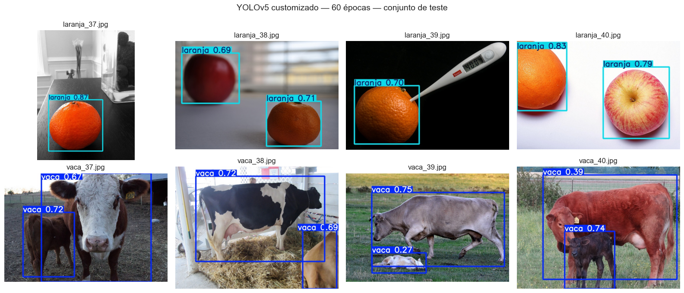

<p align="center">
<a href= "https://www.fiap.com.br/"></a>
</p>

<br>

# Fase 6 — Capítulo 1 — O despertar da Rede Neural (Visão Computacional com YOLO)

Sistema de visão computacional da **FarmTech Solutions** que detecta **vacas** e **laranjas** em fotos, construído com YOLOv5 customizado e comparado com o YOLOv5 tradicional (pesos COCO) e com uma CNN treinada do zero.

**Grupo 38 — Graduação ON em Inteligência Artificial — FIAP**

| Integrante                      | RM       |
| ------------------------------- | -------- |
| Matheus de França Fantini       | RM574078 |
| Maykon Eduardo Pereira de Sousa | RM574011 |
| Samantha Silva Farias           | RM574120 |

**Notebook (solução completa):** [`MaykonSousa_rm574011_pbl_fase6.ipynb`](MaykonSousa_rm574011_pbl_fase6.ipynb)
[](https://colab.research.google.com/github/maykonsousa/ia-fiap/blob/main/ANO1/FASE6/CAP1/MaykonSousa_rm574011_pbl_fase6.ipynb)

**Vídeo demonstrativo (≤ 5 min, YouTube não listado):** [https://youtu.be/FsosufsT5lo](https://youtu.be/FsosufsT5lo)

---

## Sumário

1. [Sobre o projeto](#1-sobre-o-projeto)
2. [Onde está cada item do enunciado](#2-onde-está-cada-item-do-enunciado)
3. [Dataset](#3-dataset)
4. [Resultados em resumo](#4-resultados-em-resumo)
5. [Como executar](#5-como-executar)
6. [Estrutura do repositório](#6-estrutura-do-repositório)
7. [Referências](#7-referências)

---

## 1. Sobre o projeto

A FarmTech Solutions ampliou seus serviços de IA e passou a atuar com visão computacional. Para mostrar a um cliente como isso funciona na prática, o grupo treinou um detector de objetos com duas classes bem diferentes do dia a dia de uma fazenda: **vaca** (rebanho) e **laranja** (produção citrícola).

Todo o passo a passo — preparação, rotulação, treino, validação, teste, comparação e conclusões — está documentado no notebook. Este README é só o mapa da entrega.

## 2. Onde está cada item do enunciado

| Item do enunciado | Onde está |
| --- | --- |
| Dataset com 40 + 40 imagens, divididas 32/4/4 | [`dataset/images/`](dataset/images) e seção 2 do notebook |
| Imagens organizadas no Google Drive | Seção 1 do notebook (estrutura `MyDrive/FarmTech_Fase6`) |
| Rotulação no Make Sense, salva no Drive | [`dataset/rotulos_makesense.zip`](dataset/rotulos_makesense.zip) e seção 2.2 do notebook |
| Colab conectado ao Drive com treino, validação e teste | Seções 1, 3 e 4 do notebook |
| Duas simulações com épocas diferentes (30 × 60) | Seção 3 do notebook |
| Conclusões sobre validação e teste + prints das detecções | Seção 4 do notebook |
| **Entrega 2:** YOLO tradicional | Seção 5 do notebook |
| **Entrega 2:** CNN treinada do zero | Seção 6 do notebook |
| **Entrega 2:** comparação (facilidade, precisão, tempo de treino e de inferência) | Seção 7 do notebook |

## 3. Dataset

- **80 imagens** reais do [COCO 2017](https://cocodataset.org) (licenças Creative Commons do Flickr): 40 de vacas e 40 de laranjas, escolhidas visualmente pelo grupo entre fotos com o objeto em destaque e no máximo 3 instâncias.
- Divisão por classe: **32 treino / 4 validação / 4 teste**.
- Rotulação feita no [Make Sense](https://www.makesense.ai) com sugestões da IA (COCO-SSD) revisadas manualmente; exportação no formato YOLO.
- [`dataset/fontes.csv`](dataset/fontes.csv) lista a origem e a licença de cada foto; [`scripts/baixar_imagens.py`](scripts/baixar_imagens.py) recria o dataset.

## 4. Resultados em resumo

Conjunto de teste: 8 imagens nunca vistas pelos modelos (4 vacas e 4 laranjas), GPU T4 no Colab.

| Abordagem | Acurácia por imagem | mAP@0.5 | Tempo de treino | Inferência |
| --- | --- | --- | --- | --- |
| YOLOv5 customizado — 30 épocas | 8/8 | 0,92 | ~145 s | ~20 ms/img |
| **YOLOv5 customizado — 60 épocas** | **8/8** | 0,88 | ~189 s | ~17 ms/img |
| YOLOv5 tradicional (pesos COCO) | 8/8 | 0,94* | — | ~19 ms/img |
| CNN treinada do zero | 6/8 | — | ~9 s | ~17 ms/img |

\* As fotos de teste vêm do COCO, o mesmo dataset usado para treinar os pesos originais do YOLOv5; esse número é otimista.

**Principais achados:** 60 épocas deixaram as caixas mais precisas (mAP@0.5:0.95 de 0,65 para 0,74 no teste) e o modelo passou a encontrar até um bezerro que não tinha sido rotulado; a maior fonte de erro foi confundir **maçãs com laranjas**; a CNN do zero, com só 64 imagens, errou exatamente as fotos que tinham maçã. Para classes próprias de cada cliente da FarmTech, o YOLO customizado é a melhor escolha.

<p align="center"></p>

Análise completa, gráficos e imagens processadas: seções 4, 7 e 8 do notebook.

## 5. Como executar

1. Copie a pasta [`dataset/`](dataset) (imagens + `rotulos_makesense.zip`) para `MyDrive/FarmTech_Fase6/` no Google Drive, deixando o zip em `FarmTech_Fase6/rotulos_makesense.zip`.
2. Abra o notebook pelo botão **Open in Colab** acima.
3. *Ambiente de execução → Alterar o tipo de ambiente → GPU T4*.
4. *Ambiente de execução → Executar tudo* e autorize o acesso ao Drive.

## 6. Estrutura do repositório

```
ANO1/FASE6/CAP1/
├── README.md
├── MaykonSousa_rm574011_pbl_fase6.ipynb   # notebook executado com toda a solução
├── dataset/
│   ├── images/{train,val,test}/           # 80 imagens (vaca_NN.jpg, laranja_NN.jpg)
│   ├── labels/{train,val,test}/           # rótulos YOLO (0 = vaca, 1 = laranja)
│   ├── rotulos_makesense.zip              # exportação original do Make Sense
│   └── fontes.csv                         # origem e licença de cada imagem
├── prints/                                # imagens de teste processadas pelo modelo
└── scripts/
    └── baixar_imagens.py                  # recria o dataset a partir do COCO
```

## 7. Referências

- Ultralytics YOLOv5 — https://github.com/ultralytics/yolov5
- Make Sense — https://www.makesense.ai
- COCO Dataset — https://cocodataset.org
- TensorFlow / Keras — https://www.tensorflow.org
